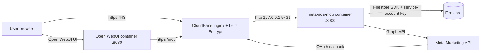

# Deploying Meta Ads MCP on a VPS with Open WebUI, Firestore and CloudPanel

This guide documents a complete, working installation of the **Meta Ads MCP
server** on a single VPS, where:

- The MCP server runs in **Docker**.
- **Open WebUI** runs in **Docker** on the same VPS and connects to the MCP as a client.
- The encrypted token store is **Google Firestore**.
- **CloudPanel** fronts the server (nginx + Let's Encrypt TLS).

It also records every change and fix that was required on the first run, because
the vanilla checkout did not work out of the box for this stack. Skip ahead to
[Required fixes](#required-fixes) for the summary of what had to change.



---

## 1. Prerequisites

- A VPS with **Docker Engine** and the **Compose plugin**.
- **CloudPanel** installed (it owns nginx + Let's Encrypt).
- A domain (e.g. `meta-mcp.example.com`) with an **A record** pointing at the VPS IP.
- A **Google Cloud project** with **Firestore in Native mode** provisioned.
- A **Meta app** at <https://developers.facebook.com> with the *Facebook Login* product.
- **Node.js is not required** on the VPS — everything builds inside Docker.

---

## 2. Install Docker on the VPS

CloudPanel does not manage Docker, so install it separately over SSH:

```bash
curl -fsSL https://get.docker.com | sh
sudo usermod -aG docker "$USER"
```

Log out and back in, then verify:

```bash
docker compose version
```

---

## 3. Clone and build the project

The prebuilt image is optional; building from source is fully supported and is
what this deployment uses.

```bash
git clone <your-fork-or-upstream-url> meta-ads-mcp
cd meta-ads-mcp
```

No build is run yet — a code change is needed first (see
[Required fixes](#required-fixes)) before the image is built.

---

## 4. Firestore service account

**Firestore is not installed on the VPS.** It is a fully-managed Google Cloud
service (<https://cloud.google.com/firestore>) — there is no Firestore process,
container, or database server running on the VPS. The only things running on the
VPS are the Docker containers (the MCP server and Open WebUI) and the CloudPanel
proxy. The app reaches Firestore over the network using a service-account key.

The container runs off-GCP, so it needs a service-account key to authenticate to
Firestore.

```bash
# 1. Create the service account
gcloud iam service-accounts create meta-ads-mcp-firestore \
  --project=YOUR_GCP_PROJECT_ID

# 2. Grant Firestore access
gcloud projects add-iam-policy-binding YOUR_GCP_PROJECT_ID \
  --member="serviceAccount:meta-ads-mcp-firestore@YOUR_GCP_PROJECT_ID.iam.gserviceaccount.com" \
  --role=roles/datastore.user

# 3. Download the key
gcloud iam service-accounts keys create sa-key.json \
  --iam-account=meta-ads-mcp-firestore@YOUR_GCP_PROJECT_ID.iam.gserviceaccount.com
```

Place `sa-key.json` in the repo root on the VPS and make it readable by the
container's non-root `node` user:

```bash
chmod 644 sa-key.json
```

The file is already covered by `.gitignore` (the fork adds `sa-key.json`) — never
commit it.

---

## 5. Configure `.env`

Copy the template and fill every field (the fork ships a trimmed
[`.env.example`](../.env.example) that lists only the fields this deployment uses):

```bash
cp .env.example .env
```

Required values:

| Variable | What it is |
|---|---|
| `SERVER_URL` | Public `https://` URL of the server |
| `GOOGLE_APPLICATION_CREDENTIALS` | `/app/sa-key.json` (path inside the container) |
| `MCP_API_KEY` | Service-to-service key (`openssl rand -hex 32`) |
| `META_APP_ID` | Numeric Meta app ID |
| `META_APP_SECRET` | 32-hex Meta app secret |
| `META_OAUTH_REDIRECT_URI` | `<SERVER_URL>/auth/meta/callback` |
| `AUTH_ALLOWED_FB_USER_IDS` | App-scoped Facebook user ID (see step 8) |
| `TOKEN_ENCRYPTION_KEY` | 64 hex chars (`openssl rand -hex 32`) |
| `SESSION_COOKIE_SECRET` | ≥ 32 chars (`openssl rand -base64 32`) |
| `OAUTH_SECRET` | ≥ 32 chars, **distinct** from `TOKEN_ENCRYPTION_KEY` |
| `FIRESTORE_PROJECT_ID` | GCP project ID |
| `META_ACCESS_TOKEN` | Optional shared fallback token |
| `GEMINI_API_KEY` | Optional single-operator fallback |
| `META_API_VERSION` | `v26.0` |
| `PORT` | `3000` (the container keeps 3000 internally) |
| `LOG_LEVEL` / `NODE_ENV` | `info` / `production` |

---

## 6. Edit `docker-compose.yml`

Three changes are required. Compose **concatenates** `ports` lists, so an override
file cannot *remove* the default `3000:3000` binding — edit the file directly.

```yaml
services:
  meta-ads-mcp:
    ports:
      - "127.0.0.1:5431:3000"        # was "3000:3000" — host 5431, container 3000
    volumes:
      - ./sa-key.json:/app/sa-key.json:ro
    healthcheck:
      test: ["CMD", "node", "-e", "fetch('http://127.0.0.1:3000/health',{headers:{'x-forwarded-proto':'https'}}).then(r=>process.exit(r.ok?0:1)).catch(()=>process.exit(1))"]
      interval: 30s
      timeout: 5s
      retries: 3
      start_period: 15s
```

Why the custom healthcheck: in production the app 301-redirects any request
without `X-Forwarded-Proto: https` ([`src/transport/http.ts`](../src/transport/http.ts:452)),
so the default `wget` probe against `http://localhost:3000/health` fails and the
container is marked `(unhealthy)` even though it is running fine.

Port `5431` is the host-side port the reverse proxy targets; the container keeps
listening on `3000`, which keeps the Dockerfile `EXPOSE` and healthcheck
consistent.

---

## 7. Reverse proxy in CloudPanel

CloudPanel manages nginx and Let's Encrypt. Do **not** edit `/etc/nginx` files
directly — CloudPanel overwrites them.

1. **Sites → Add Site** for `meta-mcp.example.com`. CloudPanel creates the vhost
   and the Let's Encrypt certificate automatically.
2. **Sites → the site → Vhost**, add this `location` block inside the
   `server { ... }` block:

```nginx
location / {
    proxy_pass http://127.0.0.1:5431;
    proxy_http_version 1.1;
    proxy_set_header Host $host;
    proxy_set_header X-Real-IP $remote_addr;
    proxy_set_header X-Forwarded-For $proxy_add_x_forwarded_for;
    proxy_set_header X-Forwarded-Proto https;
    proxy_set_header Upgrade $http_upgrade;
    proxy_set_header Connection "upgrade";
}
```

`X-Forwarded-Proto https` is required — it is what lets the app's production
HTTPS redirect and secure cookies work behind the proxy.

---

## 8. Meta app configuration

In the Meta developer console for your app:

1. **App settings → Basic**:
   - **App Domains**: add `meta-mcp.example.com`.
   - **+ Add Platform → Website**, **Site URL**: `https://meta-mcp.example.com/`.
   - **Privacy Policy URL**: a public URL with policy content (see note below).
2. **Facebook Login → Settings → Valid OAuth Redirect URIs**:

```text
https://meta-mcp.example.com/auth/meta/callback
```

3. **App Roles**: in Development mode only Admins/Developers/Testers can log in —
   make sure the Facebook account you test with is listed.

> The Privacy Policy URL must return a real page. The MCP server has no
> `/privacy` route (it is a headless API), so either host a static
> `privacy.html` in the CloudPanel docroot or use a policy generator that hosts
> the page for you.

---

## Required fixes

These are the changes without which the deployment does **not** work. They are
fork-local code/configuration changes and should not be pushed to the public
upstream repository.

### Fix 1 — Remove the `email` scope (code change)

The Facebook OAuth dialog aborted with **`Invalid Scopes: email`**, which made
Facebook redirect back to `/auth/meta/callback` **without** a `code`. The server
then correctly answered **`Missing code or state in callback`**.

The `email` scope is hardcoded in
[`src/auth/meta-oauth.ts`](../src/auth/meta-oauth.ts:7). Remove it:

```ts
const DEFAULT_SCOPES = [
  "ads_management",
  "ads_read",
  "pages_show_list",
  "pages_read_engagement",
  "business_management",
  "whatsapp_business_management",
  "public_profile",
];
```

### Fix 2 — Allowlist by app-scoped Facebook user ID

Without the `email` scope, the server cannot read the profile email, so
`AUTH_ALLOWED_EMAILS` / `AUTH_ALLOWED_DOMAINS` have nothing to match. The login
then failed with **`This Meta account is not allowed to use this server.`**

Use `AUTH_ALLOWED_FB_USER_IDS` with the **app-scoped** user ID (the Roles page
shows the *global* ID, which differs). Get the app-scoped ID from the
Graph API Explorer: select your app, get a user token, run:

```text
me?fields=id
```

Put that ID in `.env`:

```bash
AUTH_ALLOWED_FB_USER_IDS=123456789012345
```

### Fix 3 — Build with the changes applied

```bash
docker compose up -d --build
```

---

## 9. Connect Open WebUI

Open WebUI is a headless MCP client, so it does not trigger the browser consent
screen by itself — but it does support **OAuth 2.1**.

1. In Open WebUI → **MCP Servers / Tools**, add a server.
2. **URL**: `https://meta-mcp.example.com/mcp`
3. **Authentication**: **OAuth 2.1**.
4. Complete the Facebook login in the browser when Open WebUI opens the
   authorization URL.
5. Optionally configure an API-key fallback. Open WebUI's headers field expects
   **JSON** (not `Header: value`):

```json
{"X-API-Key":"<MCP_API_KEY value>"}
```

Both modes coexist: OAuth 2.1 is the per-user path; `X-API-Key` +
`X-Meta-Token` is the browserless service-to-service path.

---

## 10. Verify

```bash
# container state (must be healthy)
docker compose ps

# public health check
curl -s https://meta-mcp.example.com/health

# OAuth discovery
curl -s https://meta-mcp.example.com/.well-known/oauth-authorization-server

# backend directly on the VPS (note the X-Forwarded-Proto header)
curl -s http://127.0.0.1:5431/health -H "X-Forwarded-Proto: https"
```

End-to-end proof: ask the agent in Open WebUI to **list its ad accounts**. A
successful read against the Meta Graph API confirms Open WebUI → auth →
Firestore token → Meta all work.

---

## 11. Fork-local example files

The fork ships these so the working configuration is reproducible without
committing real secrets:

- [`.env.example`](../.env.example) — only the fields this deployment uses.
- [`sa-key.json.example`](../sa-key.json.example) — service-account key template.
- [`.gitleaks.toml`](../.gitleaks.toml) — allowlists the example key template.

---

## 12. Troubleshooting

| Symptom | Cause | Fix |
|---|---|---|
| `Cannot GET /` in the browser | The server is a headless API; there is no dashboard at `/` | Expected. Use `/health` and connect a client to `/mcp` |
| Container `(unhealthy)` but running | Healthcheck hits `:3000/health` without `X-Forwarded-Proto: https` and gets a 301 | Healthcheck with the header (step 6) |
| `Cannot GET /privacy` | No `/privacy` route exists | Host a static page or use a policy generator |
| `Invalid Scopes: email` then `Missing code or state in callback` | Facebook rejects the `email` scope and returns without a code | Remove `email` from `DEFAULT_SCOPES` (Fix 1) |
| `This Meta account is not allowed to use this server.` | Allowlist compared a global FB ID against the app-scoped ID, or the ID is wrong | Use the app-scoped ID from Graph API Explorer (Fix 2) |
| `The domain of this URL is not included in the app's domains` | Domain missing from **App Domains** | Add the domain + Website platform in Basic settings (step 8) |
| Open WebUI "header is not in JSON format" | Headers field expects JSON | Use `{"X-API-Key":"..."}` |
| No browser consent screen appears | Open WebUI does not auto-trigger the OAuth browser flow | Enable **OAuth 2.1** in Open WebUI, or use the API-key mode |

---

## 13. Security notes

- `.env` and `sa-key.json` are gitignored — **never** `git add -f` them.
- The `email`-scope removal lives in a fork and must not be pushed upstream.
- Before any commit/push, run the repository checks:

```bash
npm ci && npm run lint && npm run typecheck && npm test && npm run build
gitleaks git --redact --no-banner --config .gitleaks.toml
```

- Port `5431` must stay bound to `127.0.0.1` and closed in the firewall; only
  the CloudPanel proxy should reach it.
- Rotate any key that was ever pasted into a chat, issue tracker or commit.
